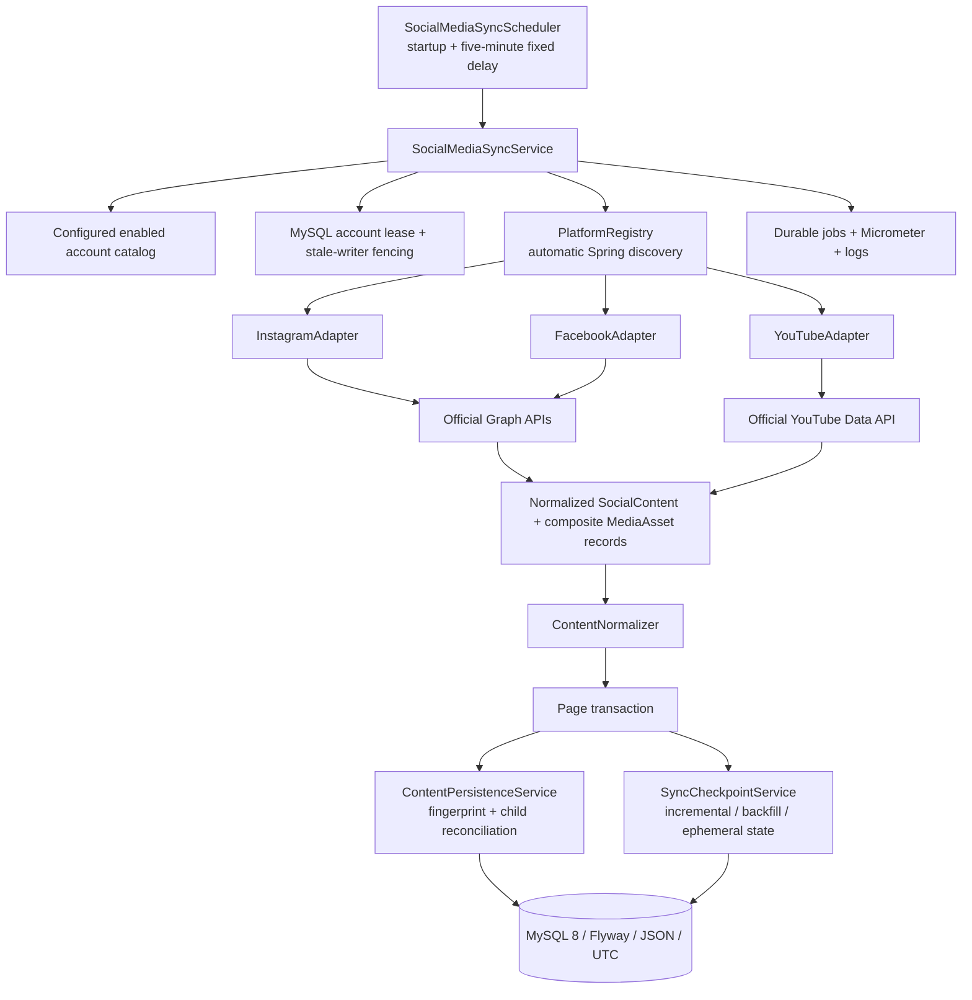

# Architecture

Adapters encapsulate provider operations. Classifiers and mappers are replaceable strategies; playlist retrieval uses a specialized mapper. Component factories group each platform's adapter/classifier/mapper. The registry discovers adapters through DI and rejects duplicate platform IDs. `AbstractGraphAdapter` supplies a template workflow with provider hooks. `SocialContent.mediaAssets` represents a composite content item. Capability declarations drive requested types and ephemeral story refresh without platform switches in the synchronization service.

Transactions never span HTTP calls. Account-level fencing protects concurrent writes. MySQL unique constraints are the final duplicate guard. Separate checkpoint rows distinguish INCREMENTAL and BACKFILL; INITIAL creates both safely. Additional fields retain unfinished bounds, reconciliation schedule, ephemeral cursors and provider cooldowns. Job rows retain counts and duration per bounded operation.
